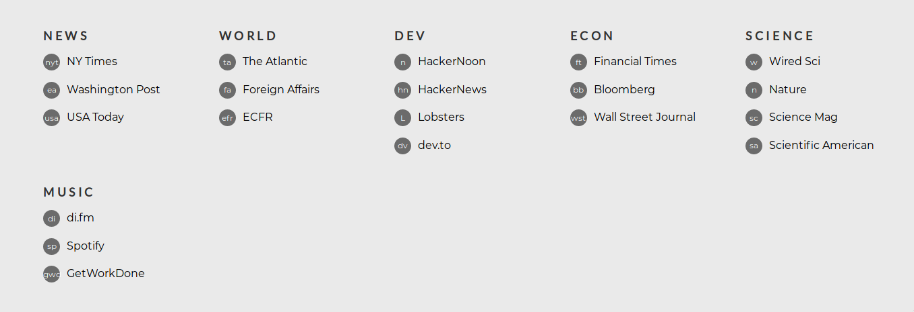

# homepage

Simple, customizable homepage.



## Setting up

The links that will be shown in the page must be defined in a .ts file inside the `src/` directory. An example file ([example_links.ts](example_links.ts)) is provided in the repo (`mv example_links.ts src` to try it out). This file must define an object named "data" that acts as a nested dictionary:

```js
"Dev": {
	"hn": {
		"url": "https://news.ycombinator.com/",
		"name": "HackerNews"
	}
}
````

Once the links file has been set up, running `npm run build` will compile the TypeScript files into the `dist` folder. The `dist/index.html` file will display the homepage.

### Future work

* Store Lato and Montserrat fonts locally.
* Add an input field when the user presses keys that will help opening links without having to reach for the mouse. Note that pressing the key of a link (e.g. "hn") followed by Enter will already work.
